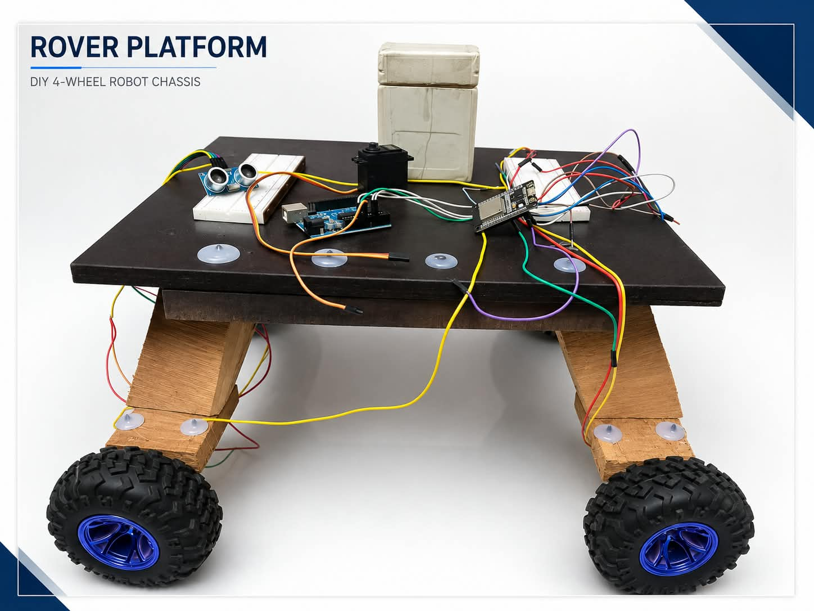

# M.O.O.N. — Intelligent Agricultural Rover 🌱

<p align="center">
  
</p>

<p align="center"><strong>Mobile Robotics · Artificial Intelligence · Computer Vision · Smart Agriculture</strong></p>

<p align="center">
  
  
  
  
</p>

<p align="center">
  <a href="https://github.com/ishansamanta/M.O.O.N-Field_Rover/tree/main/Inventory">📁 Project Inventory & Media</a>
</p>

---

## Table of Contents

1. [Project Overview](#1-project-overview)
2. [Project Vision](#2-project-vision)
3. [Key Features](#3-key-features)
4. [Rover Development — Version 1](#4-rover-development--version-1)
5. [Hardware Architecture and Components](#5-hardware-architecture-and-components)
6. [System Architecture and Working Methodology](#6-system-architecture-and-working-methodology)
7. [AI and Computer Vision Modules](#7-ai-and-computer-vision-modules)
8. [AI Demonstrations](#8-ai-demonstrations)
9. [Technology Stack](#9-technology-stack)
10. [Prototype Testing and Demonstration](#10-prototype-testing-and-demonstration)
11. [Feasibility, Challenges and Scalability](#11-feasibility-challenges-and-scalability)
12. [Expected Impact](#12-expected-impact)
13. [Development Roadmap](#13-development-roadmap)
14. [Project Team](#14-project-team)
15. [Repository Structure and Resources](#15-repository-structure-and-resources)
16. [Research and Technical References](#16-research-and-technical-references)

---

## 1. Project Overview

**M.O.O.N. (Intelligent Agricultural Rover)** is a four-wheel mobile agricultural monitoring system developed to support field-level data collection and data-driven farming decisions.

The platform brings together a mobile rover, embedded electronics, environmental sensors, camera-based image acquisition, AI/ML analysis, cloud processing, and a dedicated web dashboard. The intended workflow is to collect images and sensor readings from different locations in a field, process the information, and present useful agricultural observations through a centralized interface.

### Project Information

| Parameter | Details |
|---|---|
| Project | M.O.O.N. — Intelligent Agricultural Rover |
| Competition | Smart India Hackathon 2026 |
| Problem Statement ID | SIH26210 |
| Team ID | 177743 |
| Team Name | M.O.O.N. |
| Theme | Agriculture, Food Tech & Rural Development |
| Category | Hardware |

## 2. Project Vision

Our vision is to make agricultural field inspection more systematic through a mobile platform that combines robotics, sensing, and AI-assisted image analysis.

### One Field Scan. Multiple Agricultural Insights.

- **Crop Health Analysis:** Estimate leaf yellowness and healthy leaf area from images.
- **Pest Intelligence:** Detect and count visible insect pests.
- **Soil Recognition:** Classify soil categories from captured images.
- **Disease Detection:** Develop image-based identification of potential crop diseases.
- **Field Data Collection:** Bring camera and environmental sensor observations together.

AI outputs are intended as decision-support information and should be validated against field conditions and expert assessment.

## 3. Key Features

### 3.1 Four-Wheel Rover Mobility
- Four-wheel mobile rover platform.
- Arduino-based movement-control architecture.
- DC gear motors and motor-driver-based control.
- Servo-based mechanisms in the prototype control setup.
- Ultrasonic obstacle sensing using HC-SR04.

### 3.2 Environmental Monitoring
- Temperature and humidity sensing.
- Air-quality monitoring.
- Expandable sensor architecture for additional agricultural parameters.

### 3.3 Camera-Based Field Observation
- Crop and leaf image acquisition.
- Soil image collection.
- Rover-camera image capture for field observation.
- Computer-vision-based image processing.

### 3.4 AI/ML Agricultural Analysis

| Module | Intended function |
|---|---|
| Crop health / yellow index | Segmentation and estimation of yellow and healthy leaf regions |
| Pest detection | Detection of visible pests such as whiteflies, beetles and caterpillars |
| Soil classification | Image-based soil category recognition |
| Crop disease detection | Identification of potential disease symptoms |

### 3.5 Web Dashboard and Cloud Architecture
- Centralized monitoring through the project web dashboard.
- Visualization of sensor readings and AI outputs.
- Internet-based data transmission.
- Cloud-based storage and model processing architecture.
- Modular integration so selected AI modules can be used as required.

## 4. Rover Development — Version 1

The photograph below shows the **actual Version 1 rover prototype**. This first build was used to explore the mechanical layout, four-wheel arrangement, electronics mounting, camera placement, and basic rover-control setup.

The prototype has a raised rectangular platform supported by a four-wheel structure. Its top deck carries the camera and electronics, including the controller and power components. Initial testing of this build helped the team identify design and stability issues that informed the next mechanical iteration.

<p align="center">
  
</p>

<p align="center"><em>Figure 1. M.O.O.N. rover — Version 1 physical prototype.</em></p>

## 5. Hardware Architecture and Components

The rover separates low-level mobility control from higher-level image and data processing.

### 5.1 Main Hardware Components

| Component | Role |
|---|---|
| Raspberry Pi 3B+ | Main embedded processing and data-acquisition platform |
| Arduino UNO R3 | Rover movement and hardware control |
| DC gear motors | Four-wheel mobility |
| Motor driver | Motor direction and speed control |
| Servo motors | Actuation of mounted mechanisms |
| HC-SR04 ultrasonic sensor | Distance measurement and obstacle detection |
| DHT11 sensor | Temperature and humidity monitoring |
| MQ-135 sensor | Air-quality sensing |
| Camera / webcam | Crop, leaf, pest and soil image acquisition |
| Battery system | Power supply for rover electronics and drive |

*The table describes the planned and prototype hardware architecture; exact deployed quantities and wiring should be confirmed against the final circuit.*

### 5.2 Mechanical Design and CAD

The chassis is designed to carry the controller boards, battery, sensors, and camera equipment while maintaining a practical wheelbase for field movement.

**3D model:** [Download the Tinkercad OBJ model](Inventory/tinker.obj)

### 5.3 Circuit and Wiring

The circuit plan documents connections between the controller, motor-control hardware, sensors, and power distribution. Refer to the circuit and wiring photographs in the [Inventory folder](https://github.com/ishansamanta/M.O.O.N-Field_Rover/tree/main/Inventory).

### 5.4 Electronics Integration

The physical prototype brings together the Arduino controller, Raspberry Pi platform, breadboards, sensor modules, wiring, and camera components. The electronics layout is being refined as the rover evolves from Version 1.

### 5.5 Power Management

The rover uses a battery-based power arrangement. Power distribution and charging are important considerations for reliable motor operation and stable controller/sensor supply. The final design should keep motor power and sensitive logic supply appropriately regulated.

## 6. System Architecture and Working Methodology

### 6.1 Working Process

1. **Rover movement:** Arduino UNO controls the motor driver and rover movement.
2. **Distance sensing:** The ultrasonic sensor measures nearby obstacles.
3. **Image acquisition:** The camera captures crop, leaf, pest, and soil images.
4. **Sensor acquisition:** The embedded system reads connected environmental sensors.
5. **Data preparation:** Local software prepares images and sensor readings.
6. **AI processing:** Selected agricultural AI models analyze the submitted images.
7. **Data transmission:** Results and relevant input data are transmitted over the network.
8. **Dashboard display:** The web dashboard presents observations and analysis results.

### 6.2 Conceptual Data Flow

```text
                 AGRICULTURAL FIELD
                         |
                         v
                  FOUR-WHEEL ROVER
                         |
             +-----------+-----------+
             |                       |
             v                       v
        CAMERA SYSTEM          ENVIRONMENTAL
                                  SENSORS
             |                       |
             +-----------+-----------+
                         |
                         v
                EMBEDDED COMPUTING
                  (RASPBERRY PI)
                         |
                  IMAGE / SENSOR DATA
                         |
                         v
                  WI-FI / INTERNET
                         |
                         v
                  AI PROCESSING LAYER
            +------------+-------------+
            |            |             |
            v            v             v
        CROP HEALTH    PEST         SOIL /
        / YELLOW       DETECTION    DISEASE
        INDEX
            |            |             |
            +------------+-------------+
                         |
                         v
                   WEB DASHBOARD
                         |
                         v
                AGRICULTURAL INSIGHTS
```

This is the intended system-level workflow. Individual modules are developed and integrated progressively; it does not imply that every module is already operating simultaneously on the rover.

### 6.3 Computing and Model Deployment Plan

The project architecture separates rover control, camera/data acquisition, and AI inference. Raspberry Pi 3B+ is part of the rover-side processing setup, while the Arduino handles movement control. The team has also discussed using a separate Raspberry Pi 3B+ for selected lightweight AI workloads and remote/cloud inference for models that exceed edge-device limits.

The final deployment arrangement will depend on model size, inference speed, network availability, and hardware testing. The dashboard is intended to let operators select the AI analysis modules required for a field session.

## 7. AI and Computer Vision Modules

### 7.1 Crop Health and Yellow Index Analysis

The leaf-analysis workflow shown in the project demonstrations includes:

- Input image acquisition.
- Leaf-region segmentation.
- Extraction of the segmented leaf area.
- Identification of yellow-colored regions.
- Pixel-area calculation.
- Percentage estimation of yellow and healthy regions.
- Visualization of the segmented leaf and detected yellow region.

The percentages are image-processing estimates for the displayed samples, not laboratory measurements or independent disease diagnoses.

### 7.2 Pest Detection

The pest-detection model is being developed to identify visible insects in crop imagery. Demonstration labels include whitefly, beetle, caterpillar, and insect-pest detections. Model predictions should be evaluated for precision, recall, and field performance before being used for operational decisions.

### 7.3 Soil Classification

The soil-classification work includes image-based recognition of soil categories. The demonstration image contains labels for red soil and black soil. The displayed confidence values are model outputs for that image and should not be treated as laboratory soil tests.

### 7.4 Crop Disease Detection

Crop-disease detection is one of the AI modules being developed. It is intended to analyze crop images for potential disease symptoms. Dataset coverage, model validation, and field testing remain important before interpreting predictions as diagnoses.

## 8. AI Demonstrations

### 8.1 Leaf Health Analysis — Sample 1

**Displayed sample results**

| Metric | Result |
|---|---:|
| Segmented leaf area | 115,639 px |
| Yellow region | 1,893 px |
| Yellow area | 1.64% |
| Healthy area | 98.36% |

### 8.2 Leaf Health Analysis — Sample 2

**Displayed sample results**

| Metric | Result |
|---|---:|
| Segmented leaf area | 42,286 px |
| Yellow region | 11,092 px |
| Yellow area | 26.23% |
| Healthy area | 73.77% |

### 8.3 Soil Classification Demonstration

The soil-image example shows detections labelled **red soil** and **black soil**. The confidence scores shown in the screenshot are model predictions for the displayed image.

### 8.4 Pest Detection Demonstration

The pest-image example shows bounding-box predictions for labels including **whitefly**, **beetle**, **caterpillar**, and **insect pest**.

### 8.5 Rover-Camera AI Demonstration

A combined rover-camera output is included in the project media collection. It illustrates the intended direction of bringing rover imagery and AI detections together.

**Important media note:** The four latest demonstration images shared in this conversation (the soil-classification image, pest-detection image, laptop/team-work image, and combined rover-camera image) were not present in the GitHub `Inventory/` directory when it was inspected. They are therefore not embedded with guessed paths here. Upload those four original files into `Inventory/` to make them available for direct README embedding.

## 9. Technology Stack

| Technology | Application |
|---|---|
| Python | Data processing and system development |
| Raspberry Pi 3B+ | Embedded computing and data acquisition |
| Arduino UNO R3 | Movement and hardware control |
| Computer Vision | Image analysis and segmentation |
| AI / Machine Learning | Crop, pest, soil, and disease analysis |
| OpenCV | Image processing |
| PyTorch | AI/ML model development |
| Google Colab | Model training and testing |
| Wi-Fi / Internet | Data communication |
| Cloud services | Remote model processing and data storage |
| Web technologies | Project monitoring dashboard |

## 10. Prototype Testing and Demonstration

The team has conducted initial physical testing of Rover Version 1. These tests helped identify mechanical and structural issues and informed the decision to improve the chassis design for a more stable subsequent version.

### 10.1 Rover and Hardware Photographs

Additional prototype, sensor, and electronics photographs are maintained in the [Inventory and Work Logs folder](https://github.com/ishansamanta/M.O.O.N-Field_Rover/tree/main/Inventory).

### 10.2 Rover Demonstration Videos

- [Rover demonstration video — 8:57 PM](Inventory/WhatsApp%20Video%202026-11-22%20at%208.57.34%20PM.mp4)
- [Rover demonstration video — 9:05 PM](Inventory/WhatsApp%20Video%202026-11-22%20at%209.05.04%20PM.mp4)

### 10.3 Development Record

The repository's [Inventory & Work Logs](Inventory/Inventory%20%26%20Work%20Logs) document records work on rover design, Raspberry Pi integration, circuit connections, Arduino movement and servo control, AI model development, dataset collection, training/testing, and Version 1 testing.

## 11. Feasibility, Challenges and Scalability

### 11.1 Current Development Considerations
- Raspberry Pi-based data acquisition and embedded processing.
- Arduino-based movement control.
- Camera and environmental sensor integration.
- Modular AI model development.
- Web dashboard and cloud integration.

### 11.2 Challenges and Mitigation

| Challenge | Development approach |
|---|---|
| Uneven agricultural terrain | Improve chassis stability, wheel arrangement, and motor selection |
| Battery consumption | Measure load and improve power management |
| Sensor accuracy | Calibrate sensors and validate readings |
| Dust and moisture | Add suitable enclosure and protection |
| Weak internet connectivity | Consider local buffering and later synchronization |
| Limited edge-computing resources | Optimize models or use remote inference where appropriate |

### 11.3 Scalability
- Add further agricultural sensors.
- Expand and optimize AI/ML models.
- Improve camera placement and image quality.
- Improve dashboard reporting and field visualization.
- Develop more autonomous navigation and field coverage.

## 12. Expected Impact

M.O.O.N. aims to support more systematic field observation through mobile sensing and AI-assisted analysis.

| Impact area | Intended benefit |
|---|---|
| Social | Support easier field monitoring |
| Economic | Potentially reduce repetitive manual inspection effort |
| Environmental | Support data-informed agricultural decisions |
| Technical | Combine rover mobility, sensors, image analysis, and a dashboard |
| Scalability | Provide a platform for additional sensors and AI modules |

### Intended Users
- Farmers and agricultural workers.
- Agricultural researchers.
- Field-monitoring teams.
- Agri-tech developers and service providers.

## 13. Development Roadmap

- [x] Initial four-wheel rover mechanical prototype.
- [x] Hardware connection and wiring design.
- [x] Arduino-based movement-control code.
- [x] Raspberry Pi 3B+ integration work.
- [x] Initial leaf segmentation and yellow-index analysis demonstration.
- [x] AI model development work for pest, crop disease, and soil classification.
- [x] Initial Version 1 rover testing and design review.
- [ ] Refined and more stable rover chassis.
- [ ] Complete environmental sensor integration and calibration.
- [ ] Validate and optimize all AI models.
- [ ] Integrate selectable AI modules into the live workflow.
- [ ] Complete cloud inference and web-dashboard integration.
- [ ] Improve autonomous field navigation.
- [ ] Conduct extended field trials and model validation.

## 14. Project Team

**M.O.O.N. — Smart India Hackathon 2026**

The project is being developed by a student team combining work in mechanical design, embedded systems, rover testing, AI model development, dataset preparation, and software integration.

### Team Photograph and Development Work

Team and development photographs are maintained in the [Inventory folder](https://github.com/ishansamanta/M.O.O.N-Field_Rover/tree/main/Inventory).

### Work Log Highlights — 22 November 2026

The repository work log records the following contributions:

- **Ishan Samanta — Project Lead:** Rover redesign and sizing, Raspberry Pi 3B+ integration, controller-board circuit connections, Arduino movement and servo-control code, research into compressed models for edge computing, and Version 1 testing/design review.
- **Shouvik Show — Project Member:** Rover sizing and design, development of pest, crop-disease, yellow-index, and soil-classification AI models, Kaggle dataset collection, Google Colab training/testing, and Version 1 testing.

## 15. Repository Structure and Resources

The repository uses the `Inventory/` directory as the media and project-resource collection. File names are retained as stored in GitHub; spaces in image and video names are URL-encoded in direct links.

```text
M.O.O.N-Field_Rover/
│
├── README.md
│
└── Inventory/
    ├── 6.jpeg
    ├── Inventory & Work Logs
    ├── MOON_SIH2026_Official_Template_Fitted_Final90.pdf
    ├── WhatsApp Image 2026-11-22 at 8.57.33 PM.jpeg
    ├── WhatsApp Image 2026-11-22 at 8.57.34 PM (1).jpeg
    ├── WhatsApp Image 2026-11-22 at 8.57.34 PM.jpeg
    ├── WhatsApp Image 2026-11-22 at 8.57.35 7.jpeg
    ├── WhatsApp Image 2026-11-22 at 8.57.35 PM.jpeg
    ├── WhatsApp Image 2026-11-22 at 8.57.36 PM (1).jpeg
    ├── WhatsApp Image 2026-11-22 at 8.57.36 PM (2).jpeg
    ├── WhatsApp Image 2026-11-22 at 8.57.36 PM (3).jpeg
    ├── WhatsApp Image 2026-11-22 at 8.57.36 PM.jpeg
    ├── WhatsApp Image 2026-11-22 at 8.57.37 PM (1).jpeg
    ├── WhatsApp Image 2026-11-22 at 8.57.37 PM.jpeg
    ├── WhatsApp Image 2026-11-22 at 8.57.38 PM.jpeg
    ├── WhatsApp Image 2026-11-22 at 9.05.04 PM.jpeg
    ├── WhatsApp Image 2026-11-22 at 9.05.05 PM.jpeg
    ├── WhatsApp Video 2026-11-22 at 8.57.34 PM.mp4
    ├── WhatsApp Video 2026-11-22 at 9.05.04 PM.mp4
    ├── rover_locomotion_demo.ino
    └── tinker.obj
```

### Direct Project Resources

- [Open complete Inventory folder](https://github.com/ishansamanta/M.O.O.N-Field_Rover/tree/main/Inventory)
- [Open Arduino rover locomotion sketch](Inventory/rover_locomotion_demo.ino)
- [Download rover 3D model (.OBJ)](Inventory/tinker.obj)
- [Open official SIH project document (PDF)](Inventory/MOON_SIH2026_Official_Template_Fitted_Final90.pdf)
- [Open Inventory & Work Logs](Inventory/Inventory%20%26%20Work%20Logs)

## 16. Research and Technical References

- [Raspberry Pi Documentation](https://www.raspberrypi.com/documentation/)
- [Arduino Documentation](https://docs.arduino.cc/)
- [OpenCV Documentation](https://docs.opencv.org/)
- [PyTorch Documentation](https://pytorch.org/docs/)
- [Google Colab](https://colab.research.google.com/)
- [Food and Agriculture Organization (FAO)](https://www.fao.org/)

---

<p align="center">
  <strong>M.O.O.N. — Smarter Field Monitoring. Smarter Agricultural Decisions.</strong>
  <br><br>
  <em>Engineering Technology for the Future of Agriculture.</em>
</p>
