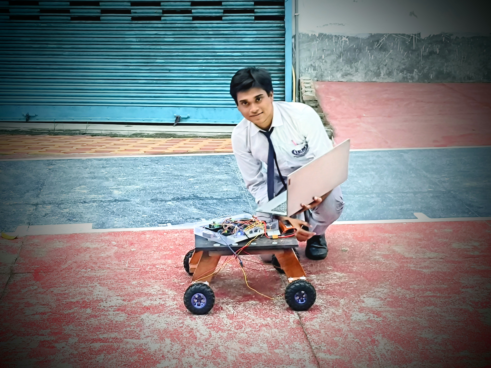

# M.O.O.N. — Intelligent Agricultural Field Rover

<p align="center">
  <strong>Mobile Field Monitoring · Computer Vision · AI-Assisted Precision Agriculture</strong>
</p>
<p align="center">
  
  
  
  
</p>
<p align="center"><em>A modular mobile platform for agricultural field observation, embedded control and AI-based image analysis.</em></p>

---

## 1. Project Overview

**M.O.O.N. (Intelligent Agricultural Field Rover)** is a mobile agricultural robotics project combining a four-wheel rover, embedded control, environmental sensing, computer vision and machine-learning experimentation.

The rover is being developed to move through agricultural environments, capture field imagery, collect sensor observations and support analysis of crop and soil conditions. Its modular architecture is intended to support edge-based AI models and a digital monitoring interface.

The project is under active development. Mechanical design, embedded control, sensing, AI models and dashboard integration are being developed progressively. Proposed capabilities are distinguished from functions already demonstrated.

## 2. Project Information

| Item | Details |
|---|---|
| Project | M.O.O.N. — Intelligent Agricultural Field Rover |
| Team | M.O.O.N. |
| Team ID | 177743 |
| Problem Statement ID | SIH26210 |
| Programme | Smart India Hackathon 2026 |
| Theme | Agriculture, Food Technology & Rural Development |
| Category | Hardware |
| Documented chassis footprint | Approximately 2 ft × 2 ft |
| Edge-computing board | Raspberry Pi 3B+ |
| Motion-control platform | Arduino UNO R3 |

## 3. Design Objectives

- Develop a mobile platform for field-level agricultural observation.
- Integrate embedded control with a stable four-wheel mechanical structure.
- Acquire crop and soil images for computer-vision workflows.
- Explore AI-assisted pest detection, crop-disease recognition, soil classification and leaf yellow-index analysis.
- Collect environmental and obstacle-distance readings.
- Establish a modular foundation for local processing, data storage and dashboard-based monitoring.

## 4. System Architecture

| Layer | Main elements | Responsibility |
|---|---|---|
| Mobility | Chassis, four DC gear motors, motor-driver circuitry | Rover movement |
| Embedded control | Arduino UNO R3, servo control | Motion and actuator control |
| Edge computing | Raspberry Pi 3B+ | Data coordination and edge-side processing |
| Image acquisition | Camera system | Crop and soil image capture |
| Sensing | DHT11, MQ-135, HC-SR04 | Environmental readings and obstacle-distance sensing |
| AI/ML | Image-analysis models | Agricultural image interpretation |
| Application | Flask-based application / dashboard work | Intended presentation of observations and results |

### Conceptual data flow

```text
             AGRICULTURAL FIELD
                     |
                     v
          +----------------------+
          |   FOUR-WHEEL ROVER   |
          |  Mobility & Control  |
          +----------------------+
                     |
             +-------+-------+
             |               |
             v               v
       +-----------+   +-------------+
       |  CAMERA   |   |   SENSORS   |
       | Crop/Soil |   | Environment |
       |  Images   |   | & Obstacles |
       +-----------+   +-------------+
             |               |
             +-------+-------+
                     |
                     v
          +----------------------+
          |   RASPBERRY PI 3B+   |
          | Data Coordination   |
          | Edge Processing     |
          +----------------------+
                     |
                     v
          +----------------------+
          |      AI / ML         |
          | Pest Detection       |
          | Disease Recognition  |
          | Soil Classification |
          | Leaf Analysis        |
          +----------------------+
                     |
                     v
          +----------------------+
          | DATA / DASHBOARD     |
          | Monitoring Interface |
          +----------------------+
```

*This is the intended high-level workflow. Actual data paths and integrations depend on the implementation status of each module.*

## 5. Hardware Inventory

The following table consolidates hardware documented in the repository and the latest development log.

| Component | Quantity / specification | Function |
|---|---|---|
| Four-wheel rover chassis | Approx. 2 ft × 2 ft | Mechanical base |
| DC gear motors | Four-motor drive arrangement | Wheel propulsion |
| Motor-driver circuitry | Controller-board drive stage | Interfaces control signals with the motors |
| Arduino UNO R3 | 1 documented controller | Motion logic and servo operation |
| Raspberry Pi 3B+ | 1 | Edge-computing and data-coordination platform |
| Servo motor(s) | Used in the control prototype | Actuation / positioning |
| Camera | Camera-based image acquisition | Crop and soil image capture |
| DHT11 | 1 documented sensor | Temperature and relative-humidity measurement |
| MQ-135 | 1 documented sensor | Air-quality / gas-response sensing |
| HC-SR04 | 1 documented sensor | Ultrasonic distance measurement |

**Inventory note:** Quantities are stated only where established by project documentation. Verified part numbers, electrical ratings and quantities for every wiring and power component are not yet documented. Confirm the physical build before treating this as a procurement bill of materials.

### Controller responsibilities

- **Arduino UNO R3:** Low-level rover movement and servo-control routines.
- **Raspberry Pi 3B+:** Linux-capable computing platform for image handling, application logic and future edge-AI integration.
- **Motor-driver stage:** Provides the motor-side drive interface; DC motors must not be powered directly from Arduino I/O pins.

## 6. Software and AI Workstreams

| Area | Tools / platform | Purpose |
|---|---|---|
| Embedded programming | Arduino IDE, C/C++ | Rover movement and servo control |
| Edge computing | Raspberry Pi OS, Python | On-device application and processing |
| Computer vision | OpenCV | Image processing and segmentation |
| Model development | Google Colab | Model training and experimentation |
| Dataset sourcing | Kaggle datasets | Training and evaluation data |
| AI deployment direction | Compressed / lightweight models | Exploring inference on resource-constrained hardware |
| Web application | Flask-based application in repository | Application and dashboard development |

### Agricultural analysis modules

1. **Pest detection** — image-based identification of visible pests.
2. **Plant-disease recognition** — classification of crop or leaf images for potential disease symptoms.
3. **Soil classification** — image-based exploration of soil-category recognition.
4. **Leaf yellow-index analysis** — segmentation and estimation of yellow and non-yellow leaf regions.

The team has collected datasets and trained or tested experimental models using Google Colab. These experiments require further validation for accuracy, field robustness and on-rover inference performance.

## 7. Development and Implementation

The development log dated **22 November 2026** records the following work:

- The field-rover structure was redesigned and its footprint documented as approximately **2 ft × 2 ft**.
- Raspberry Pi 3B+ integration and controller-board circuit connections were worked on.
- Arduino firmware was developed for rover movement and servo control.
- Version 1 testing exposed mechanical design anomalies; the structure was reconsidered to improve stability.
- Research was carried out into compact, highly compressed image models suitable for edge computing and computer vision.
- AI model work covered pest detection, crop-disease detection, yellow-index analysis and soil classification, using Kaggle datasets and Google Colab.

### Current development priorities

- Complete and verify the mechanical restructuring.
- Validate motor-driver, controller and power-distribution connections.
- Integrate camera and sensors into a repeatable data-acquisition workflow.
- Benchmark compressed models on the Raspberry Pi 3B+.
- Connect rover-side software with the application/dashboard.
- Conduct integrated testing under actual field conditions.

## 8. Project Media and Prototype Gallery

The images below are embedded from the repository's Inventory directory. They are grouped by the available development sequence. Duplicate copies of identical image files are not repeated.

### 8.1 Initial rover concept and prototype

<p align="center">
  
  
</p>
<p align="center">
  
  
</p>

### 8.2 Prototype photographs and hardware documentation

<p align="center">
  
  
</p>
<p align="center">
  
  
</p>
<p align="center">
  
  
</p>
<p align="center">
  
  
</p>
<p align="center">
  
  
</p>
<p align="center">
  
  
</p>

### 8.3 Later development and testing records

<p align="center">
  
  
</p>
<p align="center">
  
  
</p>
<p align="center">
  
  
</p>
<p align="center">
  
</p>

### 8.4 Rover demonstration videos

- [Prototype / rover demonstration — 8:57 PM](Inventory/WhatsApp%20Video%202026-11-22%20at%208.57.34%20PM.mp4)
- [Rover testing / development demonstration — 9:05 PM](Inventory/WhatsApp%20Video%202026-11-22%20at%209.05.04%20PM.mp4)

### 8.5 CAD and technical resources

- [3D model — tinker.obj](Inventory/tinker.obj)
- [Arduino locomotion firmware — rover_locomotion_demo.ino](Inventory/rover_locomotion_demo.ino)
- [Official SIH 2026 project document](Inventory/MOON_SIH2026_Official_Template_Fitted_Final90.pdf)
- [Inventory and work logs](Inventory/Inventory%20%26%20Work%20Logs)

## 9. Repository Structure

```text
M.O.O.N-Field_Rover/
├── Inventory/
│   ├── Prototype photographs and videos
│   ├── rover_locomotion_demo.ino
│   ├── tinker.obj
│   ├── Inventory & Work Logs
│   └── Official SIH project document
├── moon_rover/
│   ├── arduino/
│   └── my_flask_app/
└── README.md
```

The Arduino locomotion example and 3D model are retained in Inventory as project resources. The moon_rover directory contains the application and embedded-software work areas.

## 10. Roadmap

- [x] Initial four-wheel rover prototype.
- [x] Initial Raspberry Pi 3B+ and controller integration work.
- [x] Arduino-based locomotion and servo-control development.
- [x] Initial agricultural AI model experimentation.
- [x] Version 1 testing and identification of mechanical improvements.
- [ ] Complete mechanical restructuring and stability validation.
- [ ] Verify the full electrical and power architecture.
- [ ] Integrate camera and field sensors.
- [ ] Optimize and benchmark AI models on Raspberry Pi 3B+.
- [ ] Integrate the AI workflow with the rover application.
- [ ] Complete dashboard and data synchronization.
- [ ] Conduct sustained field trials and document performance.

## 11. Engineering Considerations

| Area | Consideration |
|---|---|
| Terrain handling | Chassis stability, wheel traction and motor torque |
| Power | Separate logic and motor power requirements; adequate regulation and protection |
| Edge inference | Memory, processor load, model size and inference time |
| Sensor reliability | Calibration, mounting and environmental interference |
| Connectivity | Local operation and deferred synchronization when network access is unavailable |
| Field deployment | Dust, moisture, vibration and secure electronics mounting |

## 12. Team and Contributions

The development log records contributions from:

| Member | Documented contribution |
|---|---|
| Ishan Samanta — Project Lead | Rover redesign and measurement, Raspberry Pi 3B+ integration, controller-board connections, Arduino locomotion and servo firmware, prototype testing and edge-model research |
| Shouvik Show — Project Member | Rover design and dimensions, AI model development for pest and disease detection, yellow-index analysis and soil classification, dataset preparation, Google Colab training/testing and prototype evaluation |

## 13. Documentation and References

- [Project source repository](https://github.com/ishansamanta/M.O.O.N-Field_Rover)
- [Inventory and prototype media](Inventory/)
- [Official SIH 2026 project document](Inventory/MOON_SIH2026_Official_Template_Fitted_Final90.pdf)
- [Raspberry Pi documentation](https://www.raspberrypi.com/documentation/)
- [Arduino documentation](https://docs.arduino.cc/)
- [OpenCV documentation](https://docs.opencv.org/)
- [Flask documentation](https://flask.palletsprojects.com/)

## 14. Future Scope

Potential development directions include improved field mobility, additional soil and crop sensors, more efficient edge-AI inference, expanded agricultural datasets, reliable offline data capture, dashboard-based historical analysis and longer-duration field validation.

## 15. Project Status

M.O.O.N. is an active hardware and software development project. The repository contains prototype media, initial locomotion firmware, a 3D model, project documentation and experimental AI work. System-level performance and field readiness will be established through further integration and testing.

---

<p align="center">
  <strong>M.O.O.N. — Intelligent Agricultural Field Rover</strong><br>
  <em>Building a practical bridge between robotics, AI and precision agriculture.</em><br><br>
  <strong>SMART INDIA HACKATHON 2026</strong>
</p>
