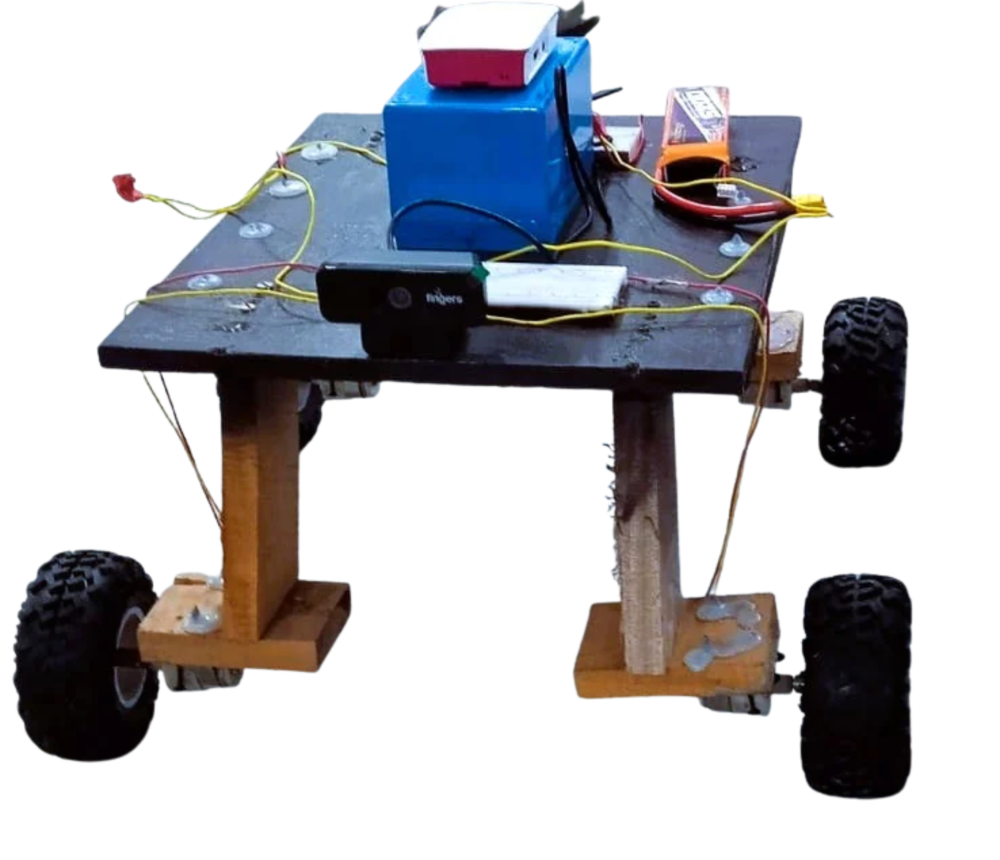
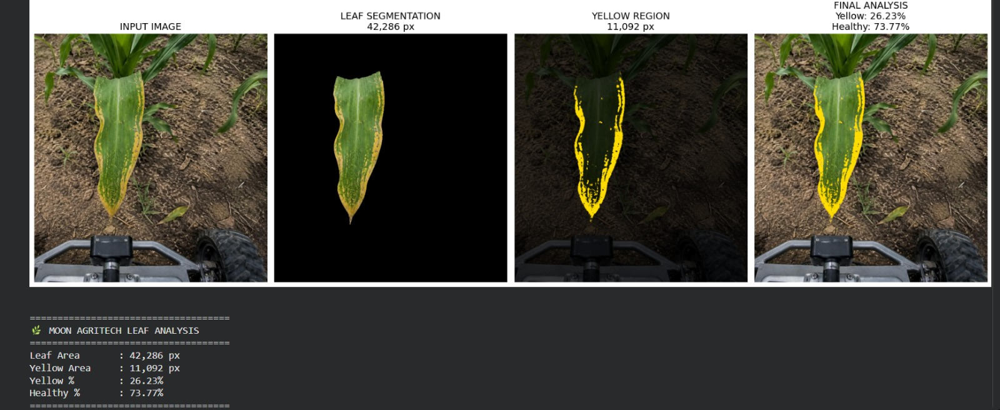
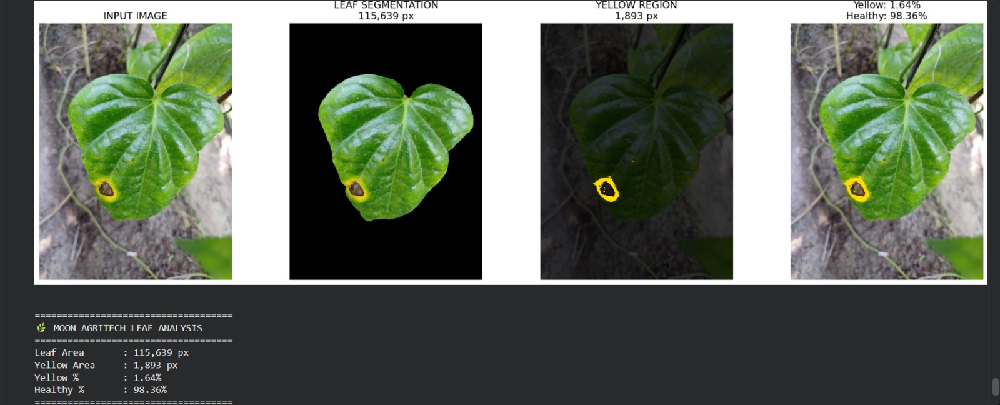
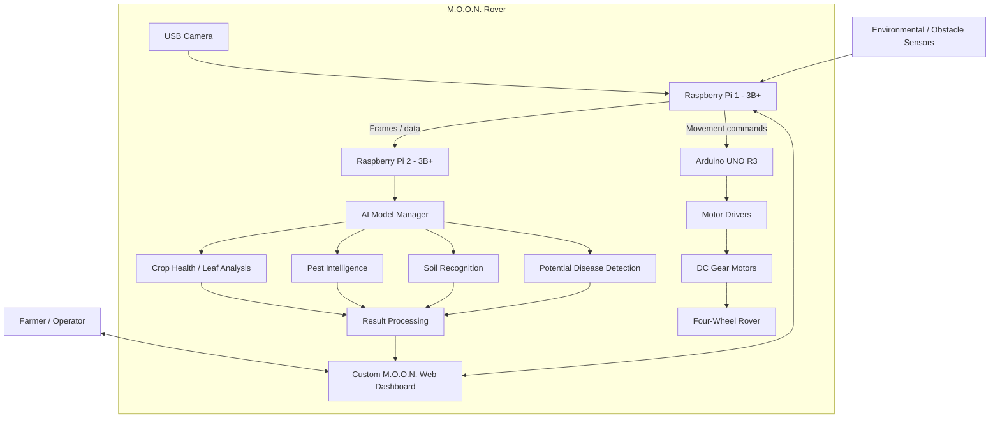

<table align="center" border="0">
<tr>
<td align="center" valign="middle">

</td>
<td  align="center" valign="middle">
<h1 style="font-size: 32px; margin: 0; white-space: nowrap;">
M.O.O.N. ROVER
</h1>
<h3 style="margin: 0;">
Mobile Observation and Object Navigation
</h3>
</td>
</tr>
</table>

<b>AI-POWERED AGRICULTURAL ROBOTICS</b>

  

  <strong>INTELLIGENT AGRICULTURAL ROVER</strong> 
  <em>One field scan. Four AI insights.</em>

  
  
  
  

  **Team ID: 177743** · **Theme: Agriculture, Food Tech & Rural Development**

---

## 📸 Project at a glance

M.O.O.N. is a student-developed agricultural rover concept that combines mobile field observation, camera-based computer vision, environmental sensing and AI/cloud processing. It is intended to collect information from multiple field locations and present useful observations through a digital dashboard.

  

<table>
<tr>
<td align="center">

 
<b>M.O.O.N. Rover Version 1 </b>
</td>
<td align="center">

 
<b>M.O.O.N. Rover Version 2</b>
</td>
</tr>
</table>

> **Project stage:** A working four-wheel prototype and early computer-vision experiments have been documented. The expanded distributed-AI rover architecture and integrated dashboard are development targets; they should not be mistaken for completed hardware.

## 🎯 Smart India Hackathon 2026

| Item | Details |
|---|---|
| Problem Statement ID | **SIH26210** |
| Problem Statement | Student Innovation — developing solutions to enhance India's primary sector, Agriculture, and manage and process agricultural produce |
| Theme | Agriculture, Food Tech & Rural Development |
| PS Category | Hardware |
| Team ID | **177743** |
| Registered Team Name | **M.O.O.N** |

## 🌱 The problem and our proposed solution

Field inspection can require repeated manual observation across different locations. M.O.O.N. proposes a mobile platform that brings together:

- Field-level data collection at multiple locations.
- Camera-based crop, leaf, pest and soil observation.
- Environmental and obstacle-related sensor inputs.
- Local processing and AI/ML analysis.
- Wireless data transfer, with local storage when connectivity is weak.
- A centralized dashboard for monitoring and visualizing results.

The aim is to help farmers, agricultural workers and field teams observe conditions more efficiently and make better-informed decisions. M.O.O.N. is an observation and decision-support platform; it does not claim to replace laboratory soil testing or expert diagnosis.

## 🤖 Four agricultural AI insights

The project concept organizes its AI/ML and computer-vision work into four areas.

| AI area | Intended output | Evidence / development note |
|---|---|---|
| **Crop health / leaf analysis** | Leaf segmentation and estimation of yellow/affected area and healthy area | Example segmentation outputs are shown below |
| **Pest intelligence** | Pest detection and count estimation | Example detections include labels such as whitefly, beetle and caterpillar |
| **Soil recognition** | Camera-based soil-type classification | Example output includes red-soil and black-soil labels |
| **Disease detection** | Identification of potential plant diseases | Part of the proposed four-insight system; validate supported disease classes and model performance before claiming deployment |

### Crop-health and leaf-segmentation experiments

The supplied analysis screenshots show an input leaf image, a segmented leaf mask, a highlighted yellow region and a final overlay. The displayed experiment reports pixel-area estimates and percentages. These are image-analysis measurements from the shown examples, not a universal plant-health diagnosis.

  

  

### Soil-recognition examples

  

### Pest-detection examples

    
  
  </a>
   
  <b>▶ Watch Pest Detection Video: </b>
   
  https://github.com/user-attachments/assets/5687132a-075f-4c32-b55d-a108fbf05c9b

The labels and confidence values visible in these screenshots are model outputs for the pictured examples. They should not be interpreted as validated field-wide pest counts or model accuracy metrics.

## 🚜 Rover prototype and mechanical development

The documented prototype is a **four-wheel rover** with a platform carrying electronics, wiring and sensing components. The current prototype photographs show a developing build rather than a finished, enclosed agricultural vehicle.

  

  

  

**Prototype direction**
- Four-wheel drive platform using four DC gear motors and motor drivers, as described in the SIH technical proposal.
- Chassis and motor mounting are being developed and tested.
- Sensor and camera placement are part of the modular design.
- Mechanical protection, power distribution and field durability require further testing.

## 🧠 System architecture

The SIH proposal describes Raspberry Pi-based processing, an Arduino UNO R3, camera-based computer vision, environmental sensors and wireless/cloud connectivity. The team's later architecture plan separates camera/communications from AI inference using two Raspberry Pi 3B+ units.

### Planned distributed architecture

**Architecture note:** This is the planned system architecture, not a claim that every block is already integrated. The SIH proposal describes Raspberry Pi 3B+ processing and Arduino UNO R3 control. The two-Pi split is the team's subsequent design direction for separating camera/communications and AI processing. The exact interface, data protocol and final deployment configuration are to be finalized during integration.

## 🔌 Electronics, sensors and technologies

The official SIH technical approach lists the following technologies and components:

| Component / technology | Proposed role |
|---|---|
| Raspberry Pi 3B+ | Main processing and data handling |
| Arduino UNO R3 | Microcontroller-based sensor and actuator interfacing |
| Python | Processing and AI/ML application development |
| Camera | Crop, leaf and soil image acquisition |
| DHT11 | Temperature and humidity sensing |
| MQ-135 | Air-quality sensing |
| HC-SR04 | Ultrasonic obstacle detection |
| Four DC gear motors + motor driver | Rover movement |
| Wi-Fi / Internet | Data communication |
| Cloud storage | Remote data storage and synchronization |
| AI/ML models | Crop health, pest, soil and potential disease analysis |

Additional soil sensors are an intended expansion area. The exact soil-sensor model and final wiring should be confirmed against the team's circuit and bill of materials before implementation.

### Circuit and electronics planning

  

  

The circuit photograph is included as a development reference. Use the finalized, checked schematic and pin map before wiring or powering the rover.

## ⚙️ Methodology / process

The proposed workflow follows these stages:

1. **Rover movement:** The four-wheel rover moves through the field. The HC-SR04 ultrasonic sensor is proposed for real-time obstacle detection.
2. **Sensor and camera acquisition:** The rover captures crop and soil images and collects temperature, humidity and air-quality readings using sensors such as DHT11 and MQ-135.
3. **Local processing:** The Raspberry Pi collects the data, filters unnecessary or incorrect information, checks data quality and prepares it for processing.
4. **Data transmission:** Images and sensor readings are sent through Wi-Fi/Internet. When connectivity is weak, data is stored locally and synchronized later.
5. **AI/ML analysis:** Image and sensor data are analyzed for crop health, pests, soil types and potential diseases.
6. **Result interpretation:** AI outputs are organized into information about field conditions, problem areas and changes over time.
7. **Dashboard visualization:** The dashboard presents monitoring information and visualizations to help farmers and administrators understand field conditions.

## 🌐 Web dashboard

M.O.O.N. is intended to use the team's own web dashboard as the central operator interface.

Planned dashboard functions:
- Live camera view.
- Selection of one or more AI analysis modules.
- Display of crop-health, pest, soil and disease-analysis results.
- Rover movement controls.
- Sensor readings and device status.
- Field observations and historical results.

The dashboard is a project integration target. Add screenshots of the actual interface here when the current dashboard build is ready.

## 🧪 Development and team work

  

  

  

  

## ✅ Feasibility, viability and risks

### Feasibility
- Uses modular, commercially available hardware.
- Uses Raspberry Pi-based processing.
- Combines a four-wheel rover with camera and sensor integration.
- Allows expansion with additional soil sensors.
- Supports cloud and AI/ML analysis.

### Viability
- Modular and scalable design.
- Supports progressive integration of agricultural sensors and AI analysis.
- Centralizes sensor and image-based field information.
- Can be extended as additional models and sensors become available.

### Challenges and mitigation strategies

| Challenge / risk | Proposed strategy |
|---|---|
| Uneven terrain | High-torque motors and a suitable chassis |
| Battery consumption | Power management and battery monitoring |
| Sensor accuracy | Sensor calibration and data filtering |
| Dust and moisture | Protective electronics enclosure |
| Poor rural connectivity | Local storage with later cloud synchronization |

## 🌾 Impact and benefits

**Target audience**
- Farmers and agricultural workers.
- Agricultural researchers and field teams.
- Agri-tech service providers.

**Expected benefits**
- **Social:** Easier and faster field monitoring.
- **Economic:** Reduced manual inspection effort and support for efficient resource use.
- **Environmental:** Data-informed use of water, fertilizers and other farm inputs.
- **Technical:** Centralized sensor and image-based field information.
- **Scalability:** Additional soil sensors and AI models can be integrated as the system develops.

M.O.O.N. aims to enable data-driven agricultural field monitoring by combining a mobile rover, sensors, imaging and AI-based analysis in one platform.

## 🛣️ Development roadmap

- [x] Initial four-wheel prototype documented.
- [x] Initial leaf-segmentation and yellow-region analysis examples documented.
- [x] Soil-recognition output examples documented.
- [x] Pest-detection output examples documented.
- [ ] Finalize rover chassis and mechanical assembly.
- [ ] Finalize motor-driver and Arduino movement integration.
- [ ] Validate sensor wiring, calibration and readings.
- [ ] Complete Raspberry Pi camera and communication pipeline.
- [ ] Implement the planned two-Pi processing arrangement.
- [ ] Integrate and validate all four AI modules.
- [ ] Complete dashboard integration.
- [ ] Test local storage and cloud synchronization.
- [ ] Conduct field trials and measure system performance.

## 📚 Research and technical references

The SIH submission identifies these reference areas and documentation sources:

**Research references**
- *Agricultural Robotics* — Annual Review: agricultural robots, sensing, automation and data-driven precision farming.
- *A Review of Robots, Perception, and Tasks in Precision Agriculture*: mobile agricultural robots, crop/soil monitoring and robotic perception.
- *Integration of Smart Sensors and IoT in Precision Agriculture*: soil sensors, IoT-based monitoring and data-driven agricultural decision-making.
- FAO — *Precision Agriculture for Smallholder Farmers*: IoT, AI, cloud computing and digital technologies in agriculture.

**Technical references**
- [Raspberry Pi Documentation](https://www.raspberrypi.com/documentation/)
- [Raspberry Pi 3 Model B+ Specifications](https://www.raspberrypi.com/products/raspberry-pi-3-model-b-plus/)
- [OpenCV Documentation](https://docs.opencv.org/)
- [PyTorch Documentation](https://pytorch.org/docs/)
- [Arduino UNO Documentation](https://docs.arduino.cc/hardware/uno-rev3/)

## 🤝 Project identity

**M.O.O.N. — Mobile Observation and Object Navigation**  
Smart India Hackathon 2026 · Team ID 177743 · Problem Statement SIH26210

  <strong>ONE FIELD SCAN. FOUR AI INSIGHTS.</strong> 
  <em>Smarter observation for smarter farming.</em>

