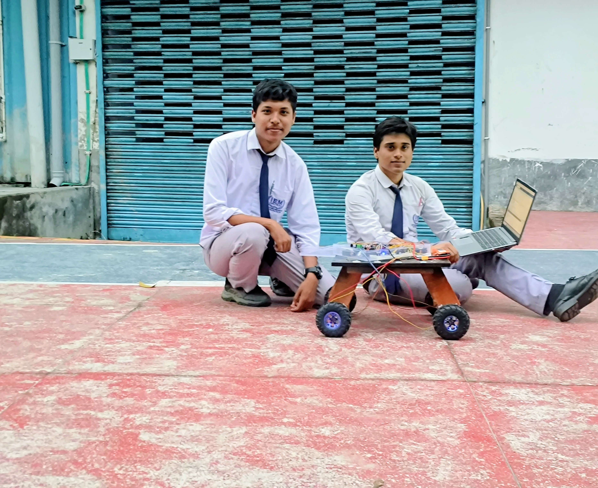
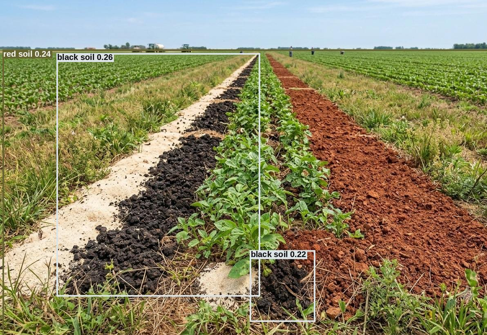
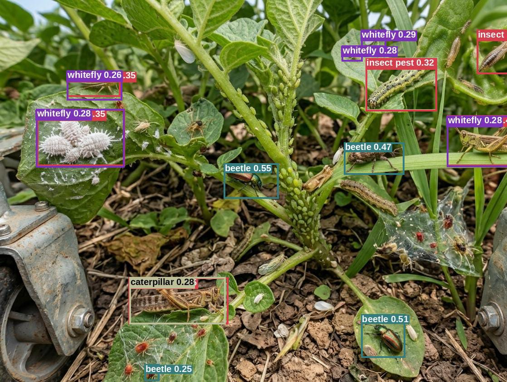
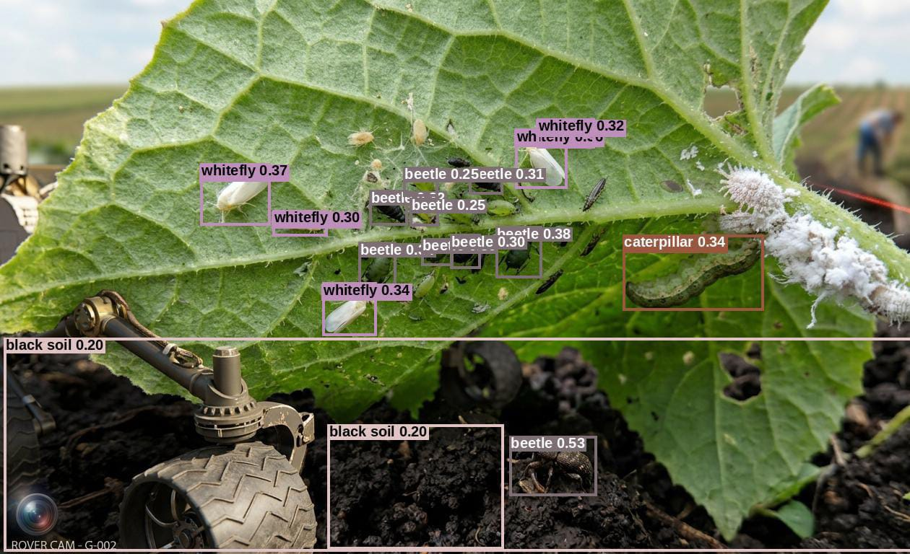
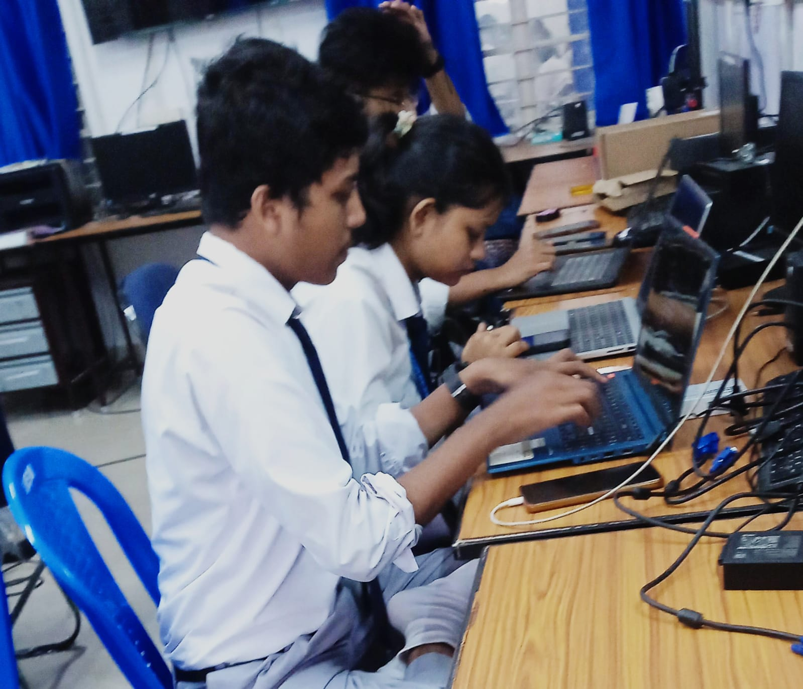
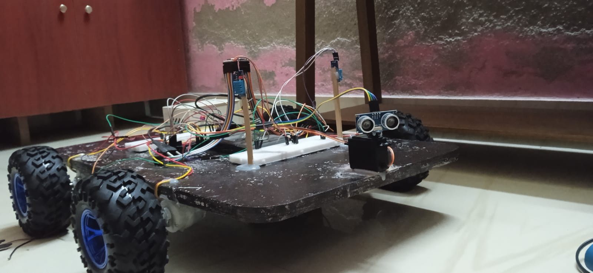

<!-- M.O.O.N. | Project README -->

<div align="center">

# M.O.O.N.
### Intelligent Agricultural Rover

**A mobile robotics platform for AI-assisted agricultural field observation**

<p>
  
  
  
  
</p>

[Project Inventory](Inventory/) · [Official SIH Document](Inventory/MOON_SIH2026_Official_Template_Fitted_Final90.pdf) · [Work Logs](Inventory/Inventory%20%26%20Work%20Logs)

</div>

---

## Contents

- [1. Project at a Glance](#1-project-at-a-glance)
- [2. Project Overview](#2-project-overview)
- [3. Rover Prototype — Version 1](#3-rover-prototype--version-1)
- [4. Project Objectives](#4-project-objectives)
- [5. System Architecture](#5-system-architecture)
- [6. Hardware Platform](#6-hardware-platform)
- [7. AI and Computer Vision Workstreams](#7-ai-and-computer-vision-workstreams)
- [8. Software and Technology Stack](#8-software-and-technology-stack)
- [9. Development Progress](#9-development-progress)
- [10. Prototype Testing and Design Iteration](#10-prototype-testing-and-design-iteration)
- [11. Project Team and Work Log](#11-project-team-and-work-log)
- [12. Project Media and Resources](#12-project-media-and-resources)
- [13. Future Development Plan](#13-future-development-plan)

---

## 1. Project at a Glance

| Item | Details |
|---|---|
| **Project name** | M.O.O.N. — Intelligent Agricultural Rover |
| **Competition** | Smart India Hackathon 2026 |
| **Problem statement ID** | SIH26210 |
| **Team ID** | 177743 |
| **Team name** | M.O.O.N. |
| **Theme** | Agriculture, Food Tech & Rural Development |
| **Category** | Hardware |
| **Current stage** | Physical prototype development and AI module development |

## 2. Project Overview

M.O.O.N. is an intelligent agricultural rover project focused on bringing together **mobile robotics, embedded electronics, camera-based observation, environmental sensing, and artificial intelligence** in a single field-oriented platform.

The rover is intended to move through agricultural areas and collect visual and sensor data. These inputs can then be processed by selected computer-vision and machine-learning modules, with relevant observations presented through the project's web dashboard.

The project is being developed as a modular system. Rover movement, image acquisition, AI inference, and dashboard interaction are treated as distinct functions so that each part can be tested and improved independently.

### The intended workflow

1. The rover moves through the field under its movement-control system.
2. A camera captures images of crops, leaves, pests, and soil.
3. Connected sensors collect environmental readings.
4. Selected AI modules process the relevant images.
5. Results and sensor information are made available to the web dashboard.
6. The operator reviews the observations to support field-level decisions.

> **Development note:** The project is under active development. The workflow above describes the intended system architecture; it should not be interpreted as a claim that every hardware and AI module is already fully integrated or operating simultaneously.

## 3. Rover Prototype — Version 1

The photograph below is the **actual Version 1 physical rover prototype**. It documents the initial mechanical and electronics arrangement developed for early testing.

<div align="center">
  <a href="rover_version_1.jpg">
    
  </a>
  <br>
  <sub><strong>Figure 1.</strong> M.O.O.N. — Version 1 rover prototype. Select the image to open the original file from the Inventory folder.</sub>
</div>

The first prototype was used to explore the platform layout, four-wheel arrangement, mounting of electronic components, camera placement, and basic rover movement. Initial testing revealed design and stability issues. The observations from this version informed the team's decision to work towards a more stable mechanical structure.

[Open the original Version 1 photograph](Inventory/rover_version_1.jpg) · [Browse all project media](Inventory/)

## 4. Project Objectives

The project aims to develop a mobile platform that can support the following agricultural observation tasks:

| Objective | Intended function |
|---|---|
| **Crop health observation** | Analyse leaf images and estimate yellow and healthy regions |
| **Pest detection** | Identify visible insect pests in crop imagery |
| **Soil classification** | Classify soil categories from captured images |
| **Crop disease analysis** | Explore image-based identification of potential disease symptoms |
| **Environmental monitoring** | Collect readings from connected environmental sensors |
| **Field data access** | Present collected information and AI outputs through a web dashboard |

AI outputs are intended to act as decision-support information. They are not a substitute for laboratory testing, agronomic assessment, or expert diagnosis.

## 5. System Architecture

The design separates low-level rover control from image acquisition and AI processing.

### 5.1 Functional architecture

```text
                   AGRICULTURAL FIELD
                           |
                           v
                    M.O.O.N. ROVER
                           |
             +-------------+-------------+
             |                           |
             v                           v
        CAMERA SYSTEM              SENSOR SYSTEM
      Crop / Leaf / Soil          Environmental Data
             |                           |
             +-------------+-------------+
                           |
                           v
                 RASPBERRY PI PLATFORM
                 Image and Data Handling
                           |
                           v
                 NETWORK / DATA TRANSFER
                           |
                           v
                   AI PROCESSING LAYER
             +-------------+-------------+
             |             |             |
             v             v             v
        CROP HEALTH      PEST         SOIL /
        & YELLOW INDEX   DETECTION    DISEASE ANALYSIS
             |             |             |
             +-------------+-------------+
                           |
                           v
                    WEB DASHBOARD
                           |
                           v
                  FIELD OBSERVATIONS
```

### 5.2 Rover movement and control

The Arduino UNO is used for low-level movement and hardware-control tasks. The rover's motor-control arrangement is intended to manage the drive motors, while servo control supports the prototype's actuation requirements.

### 5.3 Image acquisition and processing

The camera provides images for crop, leaf, pest, and soil analysis. The Raspberry Pi 3B+ is part of the rover-side computing and data-acquisition work.

### 5.4 AI deployment approach

The team is exploring compact, optimized image models for resource-constrained edge devices. A separate Raspberry Pi 3B+ for selected lightweight inference workloads and remote/cloud inference for more demanding models have also been considered. The final deployment arrangement will be decided through model-size, speed, and hardware testing.

### 5.5 Web dashboard

The project has its own web dashboard, intended to serve as the operator-facing interface for monitoring and reviewing collected information. The planned integration includes displaying sensor data and AI analysis results, with the ability to select the analysis modules required for a session.

## 6. Hardware Platform

The following components are part of the project's prototype or planned hardware architecture. Exact quantities, wiring, and final deployment should be checked against the latest circuit design.

| Component | Intended role |
|---|---|
| **Raspberry Pi 3B+** | Embedded computing, camera/data acquisition, and selected edge-processing tasks |
| **Arduino UNO R3** | Rover movement and hardware control |
| **DC gear motors** | Drive system for rover mobility |
| **Motor driver** | Motor direction and speed control |
| **Servo motors** | Control of mounted mechanisms |
| **HC-SR04 ultrasonic sensor** | Distance measurement and obstacle sensing |
| **DHT11 sensor** | Temperature and humidity measurement |
| **MQ-135 sensor** | Air-quality sensing |
| **Camera / webcam** | Image acquisition for AI and computer-vision tasks |
| **Battery system** | Power for the rover electronics and drive system |

### Mechanical design

The Version 1 prototype was used to evaluate the mechanical arrangement and component placement. The work log records a subsequent design restructuring towards a rover footprint of approximately **2 ft × 2 ft**.

- [View the rover 3D model (.OBJ)](Inventory/tinker.obj)
- [Browse mechanical and prototype photographs](Inventory/)

## 7. AI and Computer Vision Workstreams

The team is developing and testing image-based AI modules for multiple agricultural use cases.

### 7.1 Crop health and yellow-index analysis

The image-analysis workflow includes leaf-region segmentation, identification of yellow-colored pixels, pixel-area calculation, and estimation of yellow and healthy regions.

Two sample outputs documented in the project work include:

| Sample metric | Sample 1 | Sample 2 |
|---|---:|---:|
| Segmented leaf area | 115,639 px | 42,286 px |
| Yellow region | 1,893 px | 11,092 px |
| Yellow area | 1.64% | 26.23% |
| Healthy area | 98.36% | 73.77% |

These values describe the displayed image-processing samples. They are not laboratory measurements or independent diagnoses of crop health.

### 7.2 Pest detection

The pest-detection workstream focuses on detecting visible insects in crop images. The documented demonstration labels include whitefly, beetle, caterpillar, and insect-pest categories.

### 7.3 Soil classification

The soil-classification workstream explores image-based recognition of soil categories. The documented demonstration includes red-soil and black-soil labels.

### 7.4 Crop disease detection

The team is developing a crop-disease image-analysis module. The work log records dataset collection and model training/testing for this application. Further validation on representative field images is required before operational use.

### 7.5 Model development workflow

The work log records the use of Kaggle datasets and Google Colab for AI model development, training, and testing. Model optimization and deployment will be evaluated against the available edge-computing resources.

## 8. Software and Technology Stack

| Technology / platform | Project application |
|---|---|
| **Python** | AI/ML and data-processing development |
| **Arduino** | Microcontroller programming and rover movement |
| **Raspberry Pi OS / Linux environment** | Embedded computing platform |
| **Computer vision** | Image segmentation and visual analysis |
| **OpenCV** | Image-processing workflows |
| **PyTorch** | AI/ML model development |
| **Google Colab** | Model training and testing |
| **Kaggle datasets** | Dataset sourcing for model development |
| **Wi-Fi / Internet** | Data communication |
| **Cloud inference services** | Potential remote processing for models that exceed edge-device limits |
| **Web technologies** | Project dashboard and monitoring interface |

## 9. Development Progress

The checklist below reflects work recorded in the repository and the current development direction.

### Work completed or undertaken

- [x] Initial four-wheel physical rover prototype.
- [x] Initial Version 1 testing and design review.
- [x] Arduino movement and servo-control coding.
- [x] Raspberry Pi 3B+ integration work.
- [x] Controller-board circuit connection work.
- [x] Initial leaf segmentation and yellow-index analysis demonstrations.
- [x] AI model development work for pest detection, crop disease detection, and soil classification.
- [x] Dataset collection and model training/testing work using Kaggle and Google Colab.
- [x] Mechanical design review and restructuring work.

### Work in progress / planned

- [ ] Finalize and test the more stable rover mechanical structure.
- [ ] Complete sensor integration and calibration.
- [ ] Validate AI models on representative field images.
- [ ] Optimize selected models for edge computing.
- [ ] Finalize the split between local and remote AI inference.
- [ ] Integrate selected AI modules into the live rover workflow.
- [ ] Connect rover data and AI outputs to the web dashboard.
- [ ] Improve navigation and field-operation reliability.
- [ ] Conduct extended field testing.

## 10. Prototype Testing and Design Iteration

Version 1 testing was an important part of the design process. The team identified mechanical and structural issues during the initial rover tests. These observations led to a redesign effort focused on improving stability and refining the overall platform.

The development approach is iterative:

1. Build and assemble the prototype.
2. Test movement, component placement, and system behaviour.
3. Record design issues and integration constraints.
4. Revise the mechanical and electronic arrangement.
5. Retest the improved configuration.

Rover demonstration videos are available in the Inventory:

- [Rover demonstration video — 8:57 PM](Inventory/WhatsApp%20Video%202026-11-22%20at%208.57.34%20PM.mp4)
- [Rover demonstration video — 9:05 PM](Inventory/WhatsApp%20Video%202026-11-22%20at%209.05.04%20PM.mp4)

## 11. Project Team and Work Log

The repository work log records the following contributions dated **22 November 2026**.

### Ishan Samanta — Project Lead

- Worked on the field-rover design and restructuring, with the updated design targeted at a 2 ft × 2 ft footprint.
- Worked on Raspberry Pi 3B+ integration and controller-board circuit connections.
- Programmed the Arduino microcontroller for rover movement and servo control.
- Researched suitable highly compressed image-trained models for edge computing and computer vision.
- Participated in Version 1 field-rover testing, identified design anomalies, and contributed to the decision to develop a more stable mechanical structure.

### Shouvik Show — Project Member

- Worked on rover design, overall size, and measurements.
- Developed AI models for pest detection, crop disease detection, yellow-index analysis, and soil classification.
- Collected datasets from Kaggle for model training and testing.
- Trained and tested AI models using Google Colab.
- Participated in Version 1 testing and helped identify structural improvements.

[Read the complete Inventory & Work Logs](Inventory/Inventory%20%26%20Work%20Logs)

## 12. Project Media and Resources

The `Inventory/` directory is the project's source collection for prototype photographs, rover demonstration videos, technical documents, source code, and the 3D model. The gallery below embeds **all 30 image files currently stored in Inventory**. Select any thumbnail to open its original file.

### 12.1 Complete image gallery

<details open>
<summary><strong>View all 30 Inventory images</strong></summary>

<table>
<tr><td align="center" valign="top" width="33%"><a href="Inventory/1b2e333b-b999-4ff9-99aa-126fafdfacf6.jpg"></a><br><sub>1b2e333b-b999-4ff9-99aa-126fafdfacf6.jpg</sub></td><td align="center" valign="top" width="33%"><a href="Inventory/6.jpeg"></a><br><sub>6.jpeg</sub></td><td align="center" valign="top" width="33%"><a href="Inventory/6da8b729-bce1-4255-9f06-20a695723386.jpg"></a><br><sub>6da8b729-bce1-4255-9f06-20a695723386.jpg</sub></td></tr>
<tr><td align="center" valign="top" width="33%"><a href="Inventory/8b293d74-b255-4940-9a00-30b70bd94920.jpg"></a><br><sub>8b293d74-b255-4940-9a00-30b70bd94920.jpg</sub></td><td align="center" valign="top" width="33%"><a href="Inventory/Untitled%20Design.jpg"></a><br><sub>Untitled Design.jpg</sub></td><td align="center" valign="top" width="33%"><a href="Inventory/WhatsApp%20Image%202026-11-22%20at%208.57.33%20PM.jpeg"></a><br><sub>WhatsApp Image 2026-11-22 at 8.57.33 PM.jpeg</sub></td></tr>
<tr><td align="center" valign="top" width="33%"><a href="Inventory/WhatsApp%20Image%202026-11-22%20at%208.57.34%20PM%20(1).jpeg"></a><br><sub>WhatsApp Image 2026-11-22 at 8.57.34 PM (1).jpeg</sub></td><td align="center" valign="top" width="33%"><a href="Inventory/WhatsApp%20Image%202026-11-22%20at%208.57.34%20PM.jpeg"></a><br><sub>WhatsApp Image 2026-11-22 at 8.57.34 PM.jpeg</sub></td><td align="center" valign="top" width="33%"><a href="Inventory/WhatsApp%20Image%202026-11-22%20at%208.57.35%207.jpeg"></a><br><sub>WhatsApp Image 2026-11-22 at 8.57.35 7.jpeg</sub></td></tr>
<tr><td align="center" valign="top" width="33%"><a href="Inventory/WhatsApp%20Image%202026-11-22%20at%208.57.35%20PM.jpeg"></a><br><sub>WhatsApp Image 2026-11-22 at 8.57.35 PM.jpeg</sub></td><td align="center" valign="top" width="33%"><a href="Inventory/WhatsApp%20Image%202026-11-22%20at%208.57.36%20PM%20(1).jpeg"></a><br><sub>WhatsApp Image 2026-11-22 at 8.57.36 PM (1).jpeg</sub></td><td align="center" valign="top" width="33%"><a href="Inventory/WhatsApp%20Image%202026-11-22%20at%208.57.36%20PM%20(2).jpeg"></a><br><sub>WhatsApp Image 2026-11-22 at 8.57.36 PM (2).jpeg</sub></td></tr>
<tr><td align="center" valign="top" width="33%"><a href="Inventory/WhatsApp%20Image%202026-11-22%20at%208.57.36%20PM%20(3).jpeg"></a><br><sub>WhatsApp Image 2026-11-22 at 8.57.36 PM (3).jpeg</sub></td><td align="center" valign="top" width="33%"><a href="Inventory/WhatsApp%20Image%202026-11-22%20at%208.57.36%20PM.jpeg"></a><br><sub>WhatsApp Image 2026-11-22 at 8.57.36 PM.jpeg</sub></td><td align="center" valign="top" width="33%"><a href="Inventory/WhatsApp%20Image%202026-11-22%20at%208.57.37%20PM%20(1).jpeg"></a><br><sub>WhatsApp Image 2026-11-22 at 8.57.37 PM (1).jpeg</sub></td></tr>
<tr><td align="center" valign="top" width="33%"><a href="Inventory/WhatsApp%20Image%202026-11-22%20at%208.57.37%20PM.jpeg"></a><br><sub>WhatsApp Image 2026-11-22 at 8.57.37 PM.jpeg</sub></td><td align="center" valign="top" width="33%"><a href="Inventory/WhatsApp%20Image%202026-11-22%20at%208.57.38%20PM.jpeg"></a><br><sub>WhatsApp Image 2026-11-22 at 8.57.38 PM.jpeg</sub></td><td align="center" valign="top" width="33%"><a href="Inventory/WhatsApp%20Image%202026-11-22%20at%209.05.04%20PM.jpeg"></a><br><sub>WhatsApp Image 2026-11-22 at 9.05.04 PM.jpeg</sub></td></tr>
<tr><td align="center" valign="top" width="33%"><a href="Inventory/WhatsApp%20Image%202026-11-22%20at%209.05.05%20PM.jpeg"></a><br><sub>WhatsApp Image 2026-11-22 at 9.05.05 PM.jpeg</sub></td><td align="center" valign="top" width="33%"><a href="Inventory/WhatsApp%20Image%202026-11-22%20at%209.23.47%20PM.jpeg"></a><br><sub>WhatsApp Image 2026-11-22 at 9.23.47 PM.jpeg</sub></td><td align="center" valign="top" width="33%"><a href="Inventory/WhatsApp%20Image%202026-11-22%20at%209.25.14%20PM.jpeg"></a><br><sub>WhatsApp Image 2026-11-22 at 9.25.14 PM.jpeg</sub></td></tr>
<tr><td align="center" valign="top" width="33%"><a href="Inventory/WhatsApp%20Image%202026-11-22%20at%209.26.21%20PM%20(1).jpeg"></a><br><sub>WhatsApp Image 2026-11-22 at 9.26.21 PM (1).jpeg</sub></td><td align="center" valign="top" width="33%"><a href="Inventory/WhatsApp%20Image%202026-11-22%20at%209.26.21%20PM.jpeg"></a><br><sub>WhatsApp Image 2026-11-22 at 9.26.21 PM.jpeg</sub></td><td align="center" valign="top" width="33%"><a href="Inventory/WhatsApp%20Image%202026-11-22%20at%209.26.22%20PM.jpeg"></a><br><sub>WhatsApp Image 2026-11-22 at 9.26.22 PM.jpeg</sub></td></tr>
<tr><td align="center" valign="top" width="33%"><a href="Inventory/WhatsApp%20Image%202026-11-22%20at%209.26.26%20PM.jpeg"></a><br><sub>WhatsApp Image 2026-11-22 at 9.26.26 PM.jpeg</sub></td><td align="center" valign="top" width="33%"><a href="Inventory/ae0e8ca1-1191-4048-b03c-eed992e2173e.jpg"></a><br><sub>ae0e8ca1-1191-4048-b03c-eed992e2173e.jpg</sub></td><td align="center" valign="top" width="33%"><a href="Inventory/ff145f2c-4d0f-49dd-8f71-b5d5cee41a04.jpg"></a><br><sub>ff145f2c-4d0f-49dd-8f71-b5d5cee41a04.jpg</sub></td></tr>
<tr><td align="center" valign="top" width="33%"><a href="Inventory/ff9191a7-0399-433b-940f-2be64a7e7f90.jpg"></a><br><sub>ff9191a7-0399-433b-940f-2be64a7e7f90.jpg</sub></td><td align="center" valign="top" width="33%"><a href="Inventory/ffdf34b5-d517-4307-990c-b87411345011.jpg"></a><br><sub>ffdf34b5-d517-4307-990c-b87411345011.jpg</sub></td><td align="center" valign="top" width="33%"><a href="Inventory/rover_version_1.jpg"></a><br><sub>rover_version_1.jpg</sub></td></tr>
</table>
</details>

### 12.2 Rover demonstration videos

The following video files are stored in the Inventory. Open each link to view the original MP4.

- [Open video 1: WhatsApp Video 2026-11-22 at 8.57.34 PM.mp4](<Inventory/WhatsApp%20Video%202026-11-22%20at%208.57.34%20PM.mp4>)
- [Open video 2: WhatsApp Video 2026-11-22 at 9.05.04 PM.mp4](<Inventory/WhatsApp%20Video%202026-11-22%20at%209.05.04%20PM.mp4>)

### 12.3 Technical documents and project files

| Resource | Description |
|---|---|
| [Official SIH project document](Inventory/MOON_SIH2026_Official_Template_Fitted_Final90.pdf) | Project presentation / official document |
| [Inventory & Work Logs](Inventory/Inventory%20%26%20Work%20Logs) | Recorded team contributions and development updates |
| [Arduino locomotion sketch](Inventory/rover_locomotion_demo.ino) | Rover movement-control source code |
| [Rover 3D model](Inventory/tinker.obj) | OBJ-format mechanical model |
| [Complete Inventory folder](Inventory/) | Browse every stored project file |

## 13. Future Development Plan

The next development phase is focused on improving the rover's mechanical reliability and completing the integration between embedded hardware, AI inference, and the web dashboard.

Priority areas include:

1. **Mechanical refinement** — improve the chassis structure and stability based on Version 1 testing.
2. **Embedded integration** — complete the rover-side controller, camera, and sensor connections.
3. **AI optimization** — evaluate model size, accuracy, and inference speed for edge deployment.
4. **Cloud and dashboard integration** — connect selected AI services and present results through the existing web dashboard.
5. **Field validation** — test the complete workflow under realistic agricultural conditions.

---

<div align="center">

### M.O.O.N. — Intelligent Agricultural Rover

**Engineering a smarter approach to field observation.**

<sub>Smart India Hackathon 2026 · Agriculture, Food Tech & Rural Development</sub>

</div>
